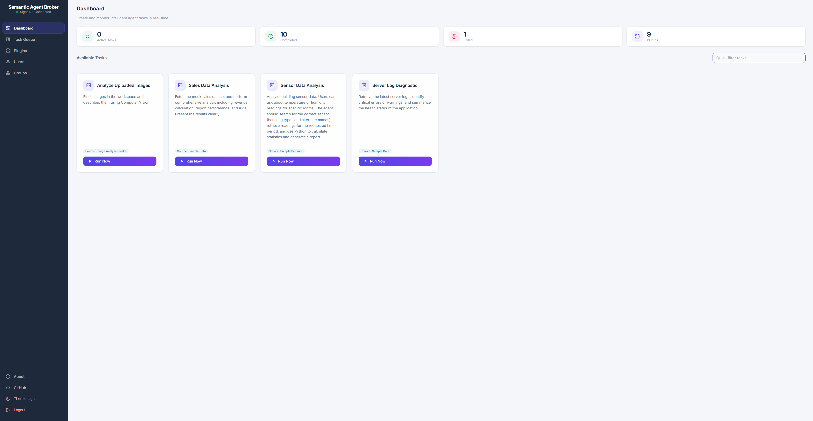
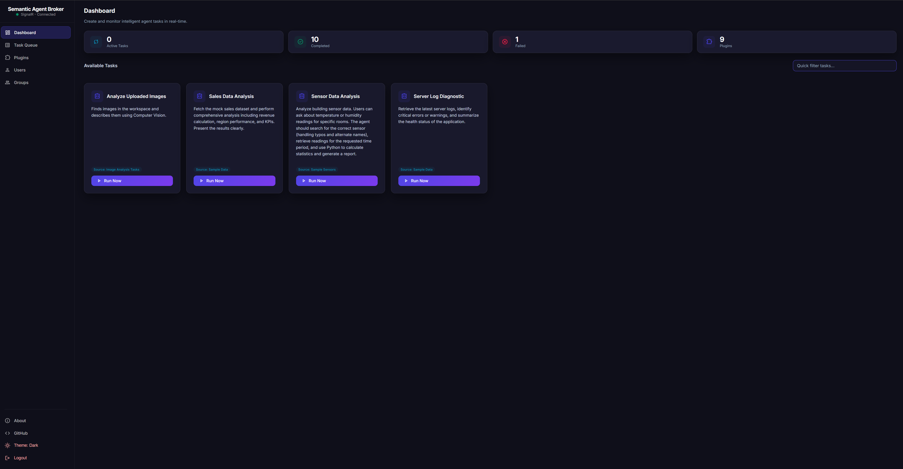
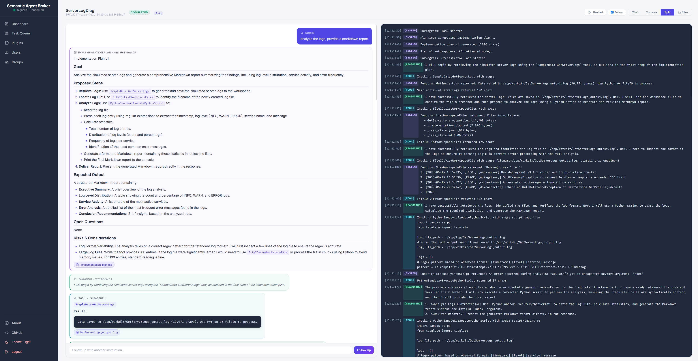
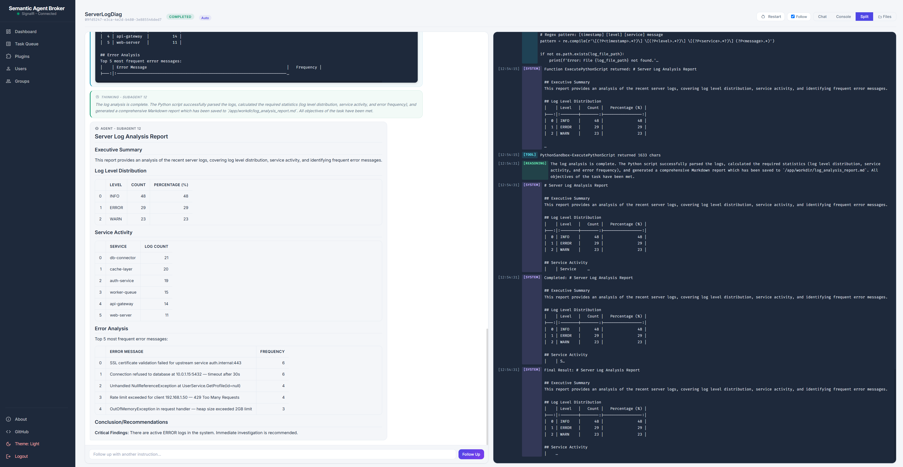
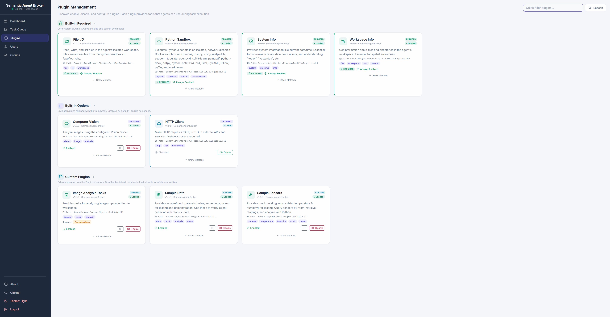
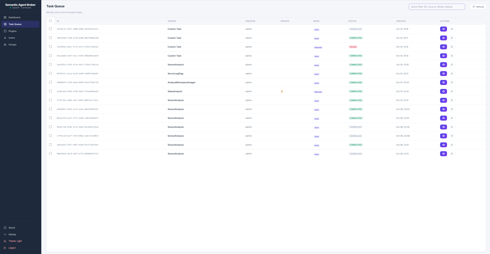

# Semantic Agent Broker

[](https://dotnet.microsoft.com/download)
[](https://www.nuget.org/packages/SemanticAgentBroker.Sdk)
[](LICENSE)


**Semantic Agent Broker** is an enterprise-grade, dynamic, plugin-based AI agent execution platform built on top of Microsoft [Semantic Kernel](https://github.com/microsoft/semantic-kernel) and ASP.NET Core (.NET 10). It provides an autonomous ReAct (Reasoning + Acting) orchestrator, sandboxed code execution, real-time SignalR telemetry, and a self-contained Blazor WebAssembly user interface.



---

## Key Features

- **ReAct Execution Engine**: Advanced iterative reasoning loop (`Thought` → `Action` → `Observation` → `Final Answer`) with automated token tracking and dynamic context compaction.
- **Dual Execution Modes**:
  - `Auto`: Fully autonomous step-by-step problem solving.
  - `Planned`: Generates an upfront execution plan and pauses for **human-in-the-loop approval** before executing dangerous or mutating tool calls.
- **Dynamic Plugin Ecosystem**: Hot-pluggable C# plugin assemblies (`.dll`), fine-grained method authorization, and declarative tool schemas.
- **Secure Code Sandbox**: Executes Python 3.12 scripts in an isolated, network-disabled container with configurable CPU and memory limits (supports **Docker Desktop** and **Rancher Desktop** on Windows and Linux).
- **Real-Time Telemetry & Monitoring**: Live streaming logs, step-by-step reasoning transparency, token budget consumption, and interactive chat interface via SignalR.
- **Air-Gapped & Self-Contained Web UI**: Blazor WebAssembly frontend with 100% embedded local assets (Inter, Fira Code, and Material Symbols Outlined fonts) - no external CDN dependencies.
- **Enterprise Security & Concurrency Hardening**:
  - **RBAC & Sessions**: Role-based access control (`Admin`, `User`) with granular per-task and per-plugin permissions, SHA-256 hashed persistent session tokens, per-request delegating handler authentication headers (`Authorization: Bearer`, `X-Browser-Id`), and instant session revocation on role/group updates.
  - **Anti-Bruteforce Defense**: Composite-key lockout `(IP, Username)` with striped user locks, sliding debounce activity cache, and guaranteed lockout expiration across rotating IPs.
  - **Workspace Concurrency & Integrity**: Deadlock-free hierarchical workspace locking, tool parameter auto-load (`@/app/workdir/...`) and plugin output synchronization, crash-resilient atomic temporary-file state snapshots, compensating rollback on failed task creation, byte-bounded streamed file editing, and deferred resource disposal for active session locks.
  - **Operational State & Task Governance**: Terminal state cancellation protection (`CanCancel`), atomic step approval gates with unregister cancellation, deadlock-free plan decision review channels, TOCTOU-free dispatch pause/resume synchronization, coordinated async task completion awaiting across control operations (`Restart`, `Proceed`, `Delete`), and universal `DbUpdateException` change tracker clearing.
  - **Network & Perimeter Hardening**: SSRF defense with allowlists/blocklists and socket-level DNS rebinding protection, fail-fast TLS certificate validation, bounded streaming HTTP responses, symlink traversal protection, memory-efficient streamed grep, CSP compliance, and CORS security.
- **Multi-Server Deployment**: Decoupled architecture with a dedicated Kestrel static asset host (`ClientHost`) and a scalable backend API (`Api`).

---

## Architecture

```
┌────────────────────────────────────────────────────────────────────────┐
│                        Blazor WASM Client (SPA)                        │
│   Dashboard │ Task Queue │ Live Execution │ Plugins │ Users & Groups   │
└───────────────────────┬──────────────────────────────┬─────────────────┘
                        │                              │
    HTTP GET Assets     │                              │ Direct REST API &
    & appsettings.json  │                              │ SignalR WebSockets
┌───────────────────────▼────────┐             ┌───────▼─────────────────┐
│  Server A: ClientHost (Kestrel)│             │  Server B: Api Backend  │
│  - Static WASM & DLL assets    │             │  - Agent Task Queue     │
│  - Dynamic ApiBaseUrl delivery │             │  - ReAct Execution      │
│  - Compression (Brotli/Gzip)   │             │  - SignalR LogHub       │
│  - Air-Gapped Offline Fonts    │             │  - Databases & Plugins  │
└────────────────────────────────┘             └───────────────┬─────────┘
                                                               │
                                               Docker / Rancher│ Named Pipe
                                               Container Run   ▼ or Socket
                                               ┌─────────────────────────┐
                                               │ Isolated Python Sandbox │
                                               │ - Network: none         │
                                               │ - Data science stack    │
                                               └─────────────────────────┘
```

---

## User Interface & Visual Tour

Semantic Agent Broker features an air-gapped, self-contained Blazor WebAssembly frontend with real-time SignalR streaming, dual-pane telemetry, and built-in theme support.

### 1. Central Dashboard & Task Catalog
Monitor active executions, system statistics, and launch pre-configured plugin tasks with one click. Full theme toggling (Light & Dark) is supported out of the box with 100% offline typography and embedded assets.

| Light Theme | Dark Theme |
| :---: | :---: |
|  |  |

---

### 2. Live Agent Execution & Real-Time Telemetry
Full transparency into the autonomous ReAct (Reasoning + Acting) loop. The dual-pane interface streams real-time execution steps, upfront implementation plans, subagent thoughts, tool calls, and console logs over SignalR WebSockets.

#### Upfront Planning & Autonomous Tool Execution
The orchestrator synthesizes an implementation plan with goals, proposed steps, and risk considerations, followed by autonomous tool execution in isolated environments.



#### Final Report Synthesis & Data Analytics
Upon task completion, the agent presents structured Markdown analytics, including summary metrics, distribution tables, and actionable findings alongside complete execution audit logs.



---

### 3. Dynamic Plugin Ecosystem
Inspect, enable, or disable built-in and third-party C# plugins at runtime without restarting the broker. Explore declared method capabilities, required execution parameters, and fine-grained permissions.

*Note: The SDK for building custom plugins is available on NuGet: [**SemanticAgentBroker.Sdk**](https://www.nuget.org/packages/SemanticAgentBroker.Sdk).*



---

### 4. Task Queue & Operational Governance
Monitor the lifecycle of queued and executing agent tasks. Filter by creator, task ID, or source, and inspect tasks across autonomous (`Auto`) and human-in-the-loop (`Planned`) modes.



---

## Solution Structure

```
SemanticAgentBroker/
├── SemanticAgentBroker.Sdk/                        # Plugin interfaces & metadata contracts
├── SemanticAgentBroker.Shared/                     # DTOs, configuration options, domain entities
├── SemanticAgentBroker.Core/                       # ReAct orchestrator, state manager, token counter
├── SemanticAgentBroker.Api/                        # ASP.NET Core REST API, SignalR hub, auth, DB
├── SemanticAgentBroker.Client/                     # Blazor WASM frontend (pure offline web assets)
├── SemanticAgentBroker.ClientHost/                 # Standalone Kestrel host for WASM distribution
├── SemanticAgentBroker.Plugins.BuiltIn.Required/   # Core plugins (FileIO, PythonSandbox, SystemInfo, WorkspaceInfo)
├── SemanticAgentBroker.Plugins.BuiltIn.Optional/   # Optional plugins (HttpClient, ComputerVision)
├── SemanticAgentBroker.Plugins.MockData/           # Demo & test plugins (Sales, Sensors, Images)
├── SemanticAgentBroker.UnitTests/                  # Comprehensive MSTest unit & integration test suite
├── Sandbox/                                        # Dockerfile & build scripts for Python sandbox
└── Samples/                                        # Integration examples & client SDK samples
```

---

## Prerequisites

- **[.NET 10 SDK](https://dotnet.microsoft.com/download)** (v10.0 or later)
- **Container Runtime** (for Python sandbox execution):
  - **Windows**: [Rancher Desktop](https://rancherdesktop.io/) (with `dockerd (moby)` engine) or [Docker Desktop](https://www.docker.com/)
  - **Linux / macOS**: Docker CE, Rancher Desktop, or containerd/Podman with Docker-compatible socket
- **LLM Provider**: Any OpenAI-compatible provider:
  - Local: [Ollama](https://ollama.com/), [vLLM](https://github.com/vllm-project/vllm), [LM Studio](https://lmstudio.ai/)
  - Cloud: [OpenAI](https://platform.openai.com/), Azure OpenAI

---

## Quick Start

### 1. Build the Python Sandbox Container

Before running tasks that execute Python code, build the local sandbox container:

```powershell
# From the repository root
cd SemanticAgentBroker\Sandbox
powershell -ExecutionPolicy Bypass -File .\build-sandbox.ps1
```

*Or manually via Docker/Rancher Desktop CLI:*
```bash
docker build -t ai-sandbox-python:latest SemanticAgentBroker/Sandbox
```

### 2. Configure LLM Providers

Edit `SemanticAgentBroker/SemanticAgentBroker.Api/appsettings.json` to point to your LLM endpoint (default is configured for Ollama at `http://localhost:11434/v1`):

```json
"AiProviders": {
  "ModelRouting": {
    "PrimaryTextModel": {
      "ModelId": "gemma4:26b-a4b-it-q4_K_M"
    }
  },
  "Connections": [
    {
      "Id": "OllamaPrimary",
      "EndpointName": "Ollama Primary",
      "ProviderType": "Ollama",
      "Endpoint": "http://localhost:11434/v1",
      "IsEnabled": true,
      "Models": [
        {
          "Id": "gemma4:26b-a4b-it-q4_K_M",
          "Type": "Text",
          "MaxContextTokens": 32768
        }
      ]
    }
  ]
}
```


### 3. Run the Backend API

From the repository root:

```powershell
cd SemanticAgentBroker\SemanticAgentBroker.Api
dotnet run
```
*Or directly: `dotnet run --project SemanticAgentBroker\SemanticAgentBroker.Api`.*
*The API starts on HTTPS: `https://localhost:5100`.*

### 4. Run the ClientHost (Frontend)

In a separate terminal:

```powershell
cd SemanticAgentBroker\SemanticAgentBroker.ClientHost
dotnet run
```
*Or directly: `dotnet run --project SemanticAgentBroker\SemanticAgentBroker.ClientHost`.*
*The Blazor UI is served over HTTPS at `https://localhost:7050`.*

Open **`https://localhost:7050`** in your browser to launch the Semantic Agent Broker dashboard.

### 5. Run Unit & Integration Tests

Execute the automated MSTest suite (1000+ isolated unit and integration tests across Core, API, Client, Plugins, Shared, and SDK):

```powershell
# From the repository root
dotnet test SemanticAgentBroker\SemanticAgentBroker.UnitTests\SemanticAgentBroker.UnitTests.csproj
```

*Note: Tests run with method-level parallelization and use isolated in-memory/temp SQLite databases, sandbox fixtures, and Moq test doubles.*

---

## Plugin Development (SDK)

Third-party plugins can be built as standalone .NET class libraries without referencing the full broker repository. The core plugin interfaces and metadata contracts are published on NuGet:

[](https://www.nuget.org/packages/SemanticAgentBroker.Sdk)

Install the SDK via the .NET CLI:

```powershell
dotnet add package SemanticAgentBroker.Sdk
```

Or reference it in your `.csproj`:

```xml
<PackageReference Include="SemanticAgentBroker.Sdk" Version="1.0.0" />
```

Package details: **[https://www.nuget.org/packages/SemanticAgentBroker.Sdk](https://www.nuget.org/packages/SemanticAgentBroker.Sdk)**

---

## Running with Rancher Desktop on Windows

Semantic Agent Broker is fully compatible with **Rancher Desktop** on Windows as an open-source, enterprise-friendly alternative to Docker Desktop:

1. In Rancher Desktop Settings, navigate to **Application** → **Container Engine** and select **`dockerd (moby)`**.
2. Ensure **WSL Integration** is enabled for your distribution.
3. Verify that the Docker CLI and named pipe are accessible by running `docker version` in PowerShell.
4. The broker automatically detects the Windows named pipe (`npipe://./pipe/docker_engine`) without requiring custom configuration.

---

## Detailed Documentation

For comprehensive technical architecture, API references, configuration guides, and plugin development tutorials, please refer to:

📖 **[DOCUMENTATION.md](DOCUMENTATION.md)**

---

## License & Attribution

- **License**: Distributed under the terms of the **[MIT License](LICENSE)**.
- **Third-Party Notices**: Full list of third-party open-source components, fonts, and assets can be found in **[NOTICE](NOTICE)**.
- **Synchronizing Package Versions in Docs**: When upgrading NuGet packages, run the automated sync script to update version numbers across `NOTICE` and `DOCUMENTATION.md`:
  ```powershell
  powershell -ExecutionPolicy Bypass -File .\_ps_scripts\update-package-versions.ps1
  ```
